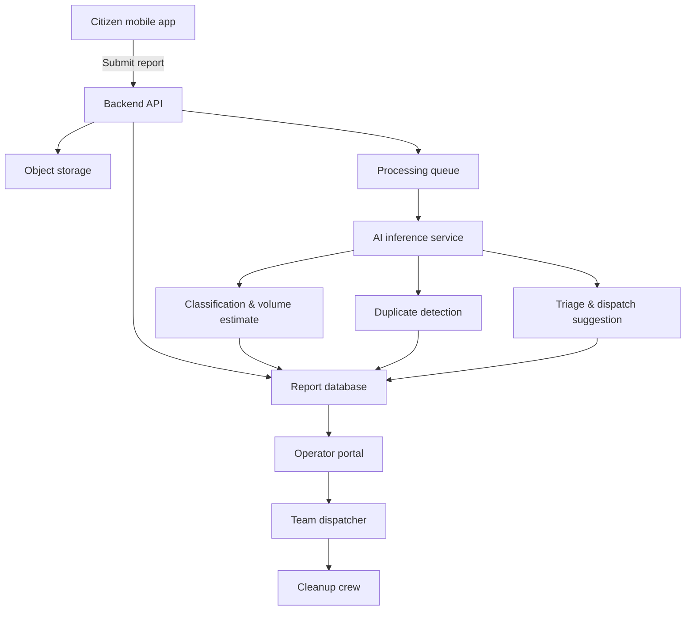

# SwachhLens Architecture

## Overview
SwachhLens is designed to capture citizen-submitted waste reports and convert them into operational intelligence for municipal cleanup teams. It is built as a low-cost, scalable system using mobile capture, cloud storage, AI inference, and an operator portal.

### Key capabilities
- Capture photo/video with GPS location, timestamp, and comments.
- Classify waste issues by type.
- Estimate waste volume into bins: small, medium, large, very large.
- Detect duplicate or related reports using geospatial and visual similarity.
- Compute priority and suggest cleanup team and vehicle.
- Display hotspots, report history, and dispatch actions.

## Components

### Mobile client
- Framework: React Native / Expo or Flutter
- Responsibilities:
  - Image/video capture
  - GPS and metadata collection
  - Submission to backend
  - Optional on-device feedback for category suggestion
- UX priorities:
  - Fast, simple reporting flow
  - Optional reference object prompts for better volume estimation
  - Privacy controls for coarse location and face redaction

### Backend API
- Framework: Node.js / Express
- Responsibilities:
  - Receive reports and media metadata
  - Store media in an object store
  - Persist report metadata in a relational store
  - Enqueue AI processing jobs
  - Provide report retrieval, hotspot aggregation, and assignment APIs

### AI services
- Classification service
  - Labels waste issue type: overflowing bin, garbage dump, plastic waste, construction debris, organic waste, e-waste, hazardous waste, drain blockage, other.
- Volume estimation service
  - Use waste region segmentation and visible scale references to derive volume bins.
  - Map area ratio and context into small/medium/large/very large.
- Duplicate detection service
  - Combine geospatial clustering with visual embeddings.
- Triage scoring
  - Score severity using volume, hazard, blockage, location sensitivity, and repeat reports.

### Data store
- Object storage for photos/videos (S3, GCS, Azure Blob, or cloud filesystem)
- Relational database for reports, assignments, teams, vehicles, and analytics (Postgres preferred)
- Redis for queueing and caching (background tasks, scheduled refresh)

### Operator portal
- Framework: React or React Admin
- Responsibilities:
  - Map view of active reports and hotspots
  - Report browsing and evidence review
  - Suggested assignment and dispatch controls
  - SLA monitoring and report tracking

### Monitoring and maintenance
- Logging, tracing, and metrics for backend and AI inference
- Model retraining workflow using labeled reports and operator feedback
- Data retention policies for privacy compliance

## Data flow

## Suggested technology stack
- Mobile: React Native + Expo or Flutter
- Backend: Node.js / Express
- AI / Models: PyTorch, TorchVision, MobileNetV3 / EfficientNet-lite, DeepLabv3+ or segmentation model
- Object store: AWS S3 / GCS / Azure Blob
- Database: PostgreSQL
- Caching & queueing: Redis + RQ/Celery
- Maps: Mapbox or OpenStreetMap / Google Maps
- Embedding index: FAISS or similar
- CI/CD: GitHub Actions, Docker

## Operational logic

### Priority scoring
Use a weighted sum of key signals to classify urgency:
- Volume: small/medium/large/very large
- Issue type: hazardous, drain blockage, e-waste
- Repeated unaddressed reports
- Location sensitivity: market, hospital, school, water body
- Time since report

### Assignment strategy
- Match team capabilities to issue type and location
- Select smallest available vehicle with adequate capacity
- Escalate hazardous or drain-blockage issues
- Use hotspot clustering for nearby reports requiring bulk deployment

## Privacy and ethics
- Make user identity optional and anonymized
- Redact or blur faces and license plates in uploaded imagery
- Support opt-out of exact coordinates and use coarse location if needed
- Apply data retention and deletion policies
- Document model limitations and bias sources

## Prototype milestones
1. Capture and store reports with metadata.
2. Add AI classification and basic user feedback.
3. Add segmentation-based volume estimation.
4. Add duplicate detection and priority scoring.
5. Add assignment recommendation and hotspot dashboard.
6. Polish UI and prepare demo with sample reports.
